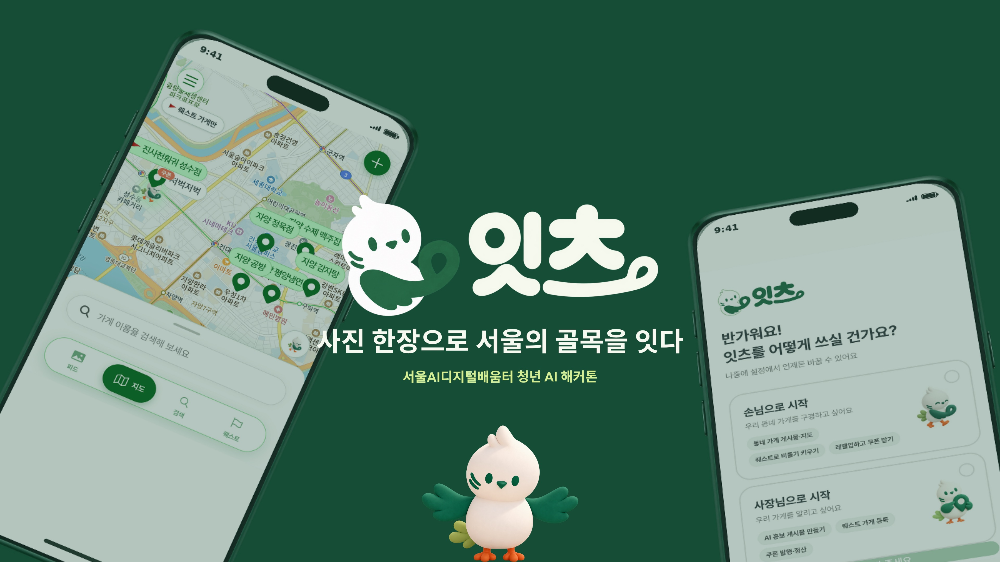
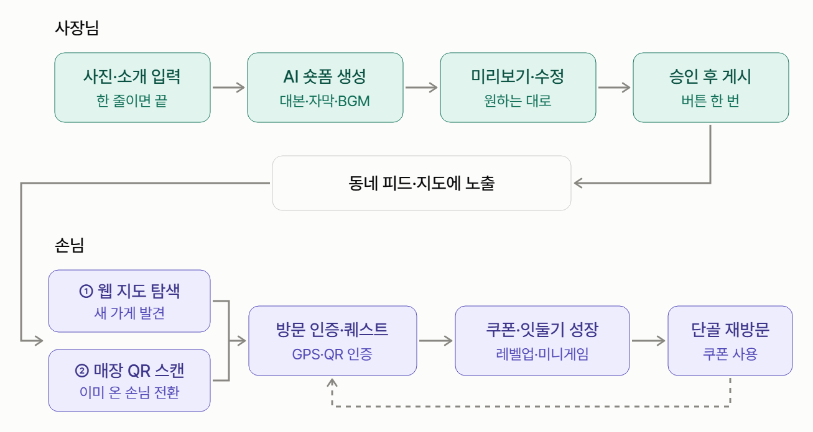

# 잇츠(ITs): AI 숏폼과 동네 지도로 서울의 골목 가게와 손님을 잇는 서비스

> [2026 서울AI디지털배움터 청년 AI 해커톤] **14팀 냥팡맨**

## 프로젝트 소개

잇츠(ITs)는 서울의 골목 소상공인과 손님을 연결하는 지역 상권 활성화 서비스입니다.

사장님이 **가게 사진과 소개 한 줄만 입력**하면 AI가 세로형 숏폼 홍보 영상을 자동으로 만들어 주고, 승인 한 번으로 **동네 손님의 피드와 지도에 바로 게시**됩니다. 손님은 웹 지도나 매장 QR로 잇츠를 만나고, 방문 퀘스트와 마스코트 '잇둘기' 육성을 통해 골목 가게 방문과 재방문으로 이어집니다.

- **선택 주제**: 소상공인 경영 문제 해결 — 지속 가능한 가게를 만드는 서울

## 해결하려는 문제

**사장님의 어려움**
- 혼자 또는 소수 인원으로 운영해 마케팅에 쓸 시간이 부족
- 영상 편집 기술 부족, 수백만 원대 숏폼 외주 제작비 부담
- 결과적으로 디지털 마케팅을 시도조차 하지 못하는 경우가 많음

**손님의 불편**
- 동네 가게의 신메뉴·할인 소식을 실시간으로 접할 채널 부족
- 유동인구가 많은 시간대에도 발길이 큰길 프랜차이즈에 머묾
- 좋은 가게가 있어도 알려지지 않아 방문·재방문으로 연결되지 않음

## 지역 데이터 기반 문제 정의

| 항목 | 수치 |
|---|---|
| 서울특별시 총인구 | 9,274,392명 |
| 60세 이상 | 2,618,073명 (28.2%) |
| 20~29세 | 1,213,935명 (13.1%) |
| 유동인구 최고 시간대 | 17~21시 |
| 매출이 가장 높은 요일 | 토요일 |

60세 이상 인구가 서울 인구의 4분의 1을 넘는 만큼 고령 사장님과 손님도 소외 없이 쓸 수 있도록 쉬운 모드를 설계했고, 숏폼 소비가 활발한 20대의 발길을 큰길 프랜차이즈에서 골목 안쪽 가게로 이어지도록 했습니다. 유동인구가 몰리는 저녁 시간대와 주말에 가게 소식이 지도와 피드에 실시간으로 노출되도록 하는 것이 목표입니다.

## 핵심 기능

| 기능 | 대상 | 설명 |
|---|---|---|
| **AI 숏폼 자동 제작·게시** | 사장님 | 사진과 소개 한 줄 입력 → 메뉴판 인식, 후킹 대본 작성, 음성 내레이션·자막·장면 전환·BGM을 입힌 세로형 숏폼 자동 생성. 미리보기로 수정 후 승인하면 피드·지도에 바로 게시 |
| **웹 지도 탐색** | 손님 | 앱 설치·회원가입 없이 내 주변 가게와 새 소식을 거리순으로 탐색. 숏폼, 신메뉴·할인 소식, 영업 상태를 지도에서 한눈에 확인 |
| **매장 QR 유입** | 손님 | 계산대의 잇츠 QR을 찍으면 다음 방문 쿠폰 지급. 이미 방문한 손님을 플랫폼 사용자로 전환해 초기 사용자 확보 문제 해결 |
| **잇둘기 육성·미니게임** | 손님 | 방문 인증과 퀘스트(예: 동네 가게 3곳 방문) 달성으로 마스코트 '잇둘기' 성장, 레벨업·미니게임으로 쿠폰 등 혜택 획득 |
| **숏폼 레퍼런스 공유 보상** | 공통 | 마음에 드는 숏폼을 레퍼런스로 공유하면 추가 혜택. 공유된 레퍼런스로 AI가 최신 트렌드를 학습해 영상 품질이 계속 개선 |
| **모두를 위한 접근성** | 공통 | 큰 글씨·음성 안내를 지원하는 쉬운 모드, 배리어프리 정보 표시 |

## 서비스 흐름

## 수익 구조

잇츠는 **기본 기능을 무료로 제공**해 사장님과 손님의 진입장벽을 낮추고, 실제 방문 성과가 생기는 지점에서 수익을 냅니다.

| 수익원 | 대상 | 방식 |
|---|---|---|
| **쿠폰 사용 수수료** | 사장님 | 손님이 실제로 방문해 쿠폰을 사용한 건에 대해서만 수수료 정산 (성과 기반) |
| **퀘스트 가게 등록** | 사장님 | '동네 가게 3곳 방문하기' 등 탐방 퀘스트 코스에 가게를 등록해 우선 노출 |
| **Pro 구독** | 사장님 | 숏폼 무제한 생성·수정, 레퍼런스 기반 맞춤 스타일, 인기 가게 우선 정렬 등 고급 기능 |
| **제휴 (확장)** | 결제·지역 파트너 | 네이버페이 등 간편결제, 지역 상품권과 연계한 방문 쿠폰·리워드 지급 |

### 참여자별 가치

| 구분 | 얻는 것 |
|---|---|
| **사장님** | 외주 제작비 없이 숏폼 마케팅 시작, 효과가 확인된 방문에만 비용 지불 |
| **손님** | 동네 가게 방문·퀘스트 달성만으로 쿠폰과 포인트 적립, 레퍼런스 공유 시 추가 혜택 |
| **플랫폼** | 수익을 손님 보상과 AI 품질 개선에 재투자해 이용자와 가게가 함께 늘어나는 선순환 |

## 기술 스택

| 구분 | 기술 |
|------|------|
| Frontend | React 19, TypeScript, Vite, Tailwind CSS |
| 상태관리 | Zustand, TanStack Query |
| Backend | Spring Boot 4, Java 21, Spring Security, JPA |
| Database | MySQL, H2 (로컬) |
| Infra | AWS EC2, S3, CloudFront |
| CI/CD | GitHub Actions, Docker, GHCR |
| 인증 | JWT, 이메일 인증 (SMTP) |
| 메뉴판 인식 (OCR) | Claude (AWS Bedrock) |
| AI 영상 프롬프트·나레이션 대본 작성 | Claude (AWS Bedrock) |
| 게시물 소개 글 작성 | Claude (AWS Bedrock) |
| AI 영상 클립 생성 | Runway API (Gen-4 Turbo) |
| AI 메뉴 이미지 생성 | Runway API (Gen-4 Image) |
| 나레이션 음성 (TTS) | AWS Polly |
| 영상 편집·자막·타이틀 합성 | FFmpeg |
| 지도 | Kakao Maps |
| QR 생성·인증 | qrcode.react, HMAC |
| 가게 정보 불러오기 | Jsoup (네이버·카카오 지도 링크) |
| 웹 스크래핑 | Jsoup, Playwright |
| API 문서 | Swagger (SpringDoc OpenAPI) |

## 기대 효과

- 소상공인의 숏폼 제작 부담과 디지털 마케팅 진입장벽 해소
- 손님의 동네 가게 발견과 방문·재방문 기회 확대
- 성과 기반 쿠폰과 퀘스트를 통한 골목상권 내 소비 순환
- 고령층과 이동약자를 포함한 모든 세대의 정보 접근성 향상
- (확장) 네이버페이 등 간편결제 제휴를 통한 방문 쿠폰 지급

## 로컬 실행

서버·화면을 내 컴퓨터에서 띄우는 방법은 [SETUP.md](SETUP.md)를, 신규 기능을 어디에 만들지는 [docs/new-features.md](docs/new-features.md)를, 외부 API·키·오픈소스는 [docs/public-apis.md](docs/public-apis.md)를 참고하세요.

## 팀원 소개
## 팀원 소개

> **14팀 냥팡맨**

|  |  |  |  |  |
|:------------------------------------------------------:|:---:|:---:|:---:|:----------------------------------------:|
|           [성현주](https://github.com/LEELMIO)            | [이채원](https://github.com/CW-YI) | [임지오](https://github.com/imzioim) | [장서현](https://github.com/jangsh7) |                   임아연                    |
|                리뷰, QR 인증·보상, 알림, 서버                 | AI 영상 프롬프팅·제작 | AI 영상 제작, 성과 조회 리포트 | 지도, 사용자 편의  모드,CI/CD 배포 |             기획, UI/UX 디자인             |

## 참고 자료

- 2026 서울AI디지털배움터 청년 AI 해커톤
- 서울시 상권분석서비스, 소상공인시장진흥공단 상권분석 데이터
- 행정안전부 주민등록 인구통계