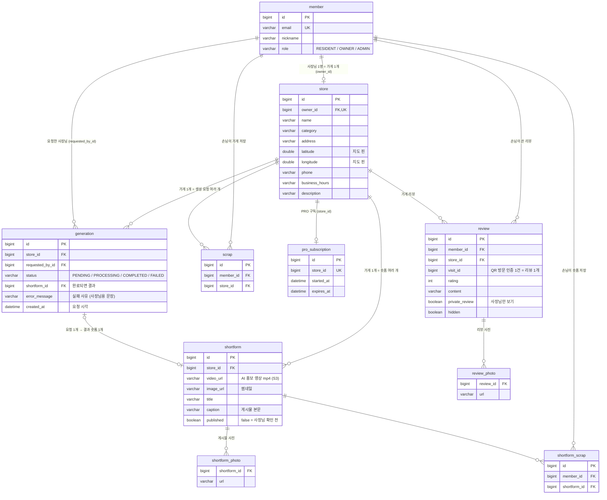
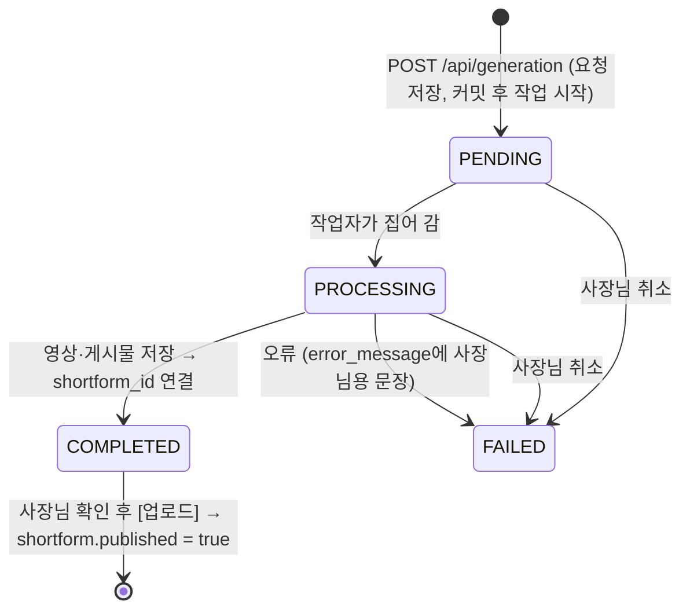

# DB 스키마 (MySQL)

잇다 서버의 테이블 구조와 연결, 영상 생성 요청이 처리되는 흐름입니다. 테이블은 JPA 엔티티(`domain/*/entity`)에서 만들어지고, 운영 DB에 바꿀 점은 [`sql/`](sql/)에 날짜별 SQL로 남깁니다. 모든 테이블에는 `created_at`·`updated_at`이 있습니다 (`BaseTimeEntity`).

## 1. 핵심 테이블 관계 (숏폼 생성 · 피드 · 지도)

### 화면별로 쓰는 테이블

| 화면 | 테이블 | 방식 |
| --- | --- | --- |
| **지도** | `store` | 가게의 `latitude`·`longitude`로 핀을 찍습니다. 지도 전용 게시물 테이블은 없고, 핀을 누르면 그 가게의 공개 숏폼(`shortform.store_id`)을 보여 줍니다 |
| **피드** | `shortform` | `published = true`인 숏폼을 PRO 가게 먼저, 그다음 최신순으로 (`GET /api/shortforms`). 피드 전용 테이블은 없습니다 |
| **숏폼 만들기** | `generation` → `shortform` | 아래 2절 |
| **저장(스크랩)** | `shortform_scrap`, `scrap` | 회원 + 숏폼 / 회원 + 가게, 같은 쌍은 한 번만 (UNIQUE) |
| **리뷰** | `review`, `review_photo` | QR 방문 인증(`quest_visit`) 1건당 리뷰 1개. 리뷰를 쓰면 보상 뽑기권(`review_draw_ticket`)이 생기고 사장님께 알림(`notification`) |
| **PRO** | `pro_subscription` | 가게별 구독 기간. 구독 중이면 피드 우선 노출 |

## 2. 영상 생성 요청 = `generation` 테이블 (대기열)

영상 하나를 만드는 데 1~3분이 걸려서, 요청을 바로 처리하지 않고 `generation` 행으로 먼저 저장한 뒤 비동기 작업자가 처리합니다. 앱은 `GET /api/generation/{id}`로 상태를 조회(폴링)합니다.

| 단계 | 저장되는 것 |
| --- | --- |
| 요청 | `generation`(가게, 요청자, `PENDING`) — 같은 가게에 진행 중인 요청이 있으면 막음 (`GENERATION409`) |
| 처리 | 메뉴판 읽기 → 사진이 모자라면 메뉴 이미지 생성 → 장면 JSON → 영상 합성 → S3 업로드 |
| 완료 | `shortform`(비공개, `video_url`) 저장 후 `generation.shortform_id` 연결, `COMPLETED` |
| 실패·취소 | `FAILED` + `error_message` ("영상을 만들지 못했어요…" / "사장님이 생성을 취소했어요"). 오류 원문은 서버 로그에만 |
| 공개 | 사장님이 결과를 보고 [업로드] → `shortform.published = true` → 피드·지도에 노출 |

작업자는 서버 안의 스레드 풀입니다 (`AsyncConfig`: 동시 2개, 대기 50개). 요청과 상태는 DB에 남으므로 진행 상황과 기록은 사라지지 않습니다.

## 3. 그 밖의 테이블 (쿠폰 · 비둘기 · 퀘스트)

이 테이블들은 JPA 연관 대신 ID 숫자(`member_id`, `store_id` …)로 연결합니다.

| 묶음 | 테이블 | 내용 |
| --- | --- | --- |
| 쿠폰 | `coupon`, `user_coupon`, `coupon_redemption` | 가게가 만든 쿠폰 → 손님이 받은 쿠폰(코드·만료) → 가게에서 사용한 기록 |
| 비둘기 키우기 | `pigeon`, `pigeon_level_history`, `pigeon_graduation`, `feed_log` | 회원별 비둘기, 레벨업 보상, 졸업, 먹이 기록 |
| 퀘스트 | `quest`, `quest_participation`, `quest_subscription`, `quest_visit`, `quest_completion`, `quest_event_log` | 가게 방문 퀘스트, 참여 가게, QR 방문 인증, 완료 |
| 리뷰 보상 | `review_draw_ticket`, `review_draw` | 방문 인증 1건당 뽑기권 → 먹이 또는 쿠폰 |
| 알림 | `notification` | 받는 회원, 종류(리뷰 등록 등), 관련 가게·리뷰, 읽음 여부 |

## 4. AI 레포를 합치면 추가되는 칼럼

AI 홍보 영상 파이프라인(NyangPang/AI)을 합치면 아래 칼럼이 추가됩니다 (`sql/2026-11-20-revision-count.sql`).

| 테이블 | 칼럼 | 용도 |
| --- | --- | --- |
| `shortform` | `revision_count INT NOT NULL DEFAULT 0` | 게시물 수정 횟수. 무료는 3번까지, PRO 구독 중이면 무제한 |
| `generation` | `revision_count INT NOT NULL DEFAULT 0` | 이 요청이 몇 번째 수정인지 |

## 5. 다음에 보강할 점

- **서버 재시작 복구:** 처리 중에 서버가 재시작되면 그 요청이 `PROCESSING`으로 남습니다. 서버가 켜질 때 오래된 `PENDING`·`PROCESSING`을 `FAILED`("다시 시도해 주세요")로 정리할 예정입니다. 규모가 커지면 대기열을 메시지 큐(SQS 등)로 옮깁니다.
- **리뷰 → 영상 연결:** 리뷰는 `review` 테이블에 쌓이지만 아직 영상 생성에 쓰이지 않습니다. 가게의 공개 리뷰에서 키워드를 뽑아 영상 장면 JSON의 `review_keywords`로 넘기면, "손님들이 말하는 맛"을 영상과 게시물 본문에 담을 수 있습니다.
